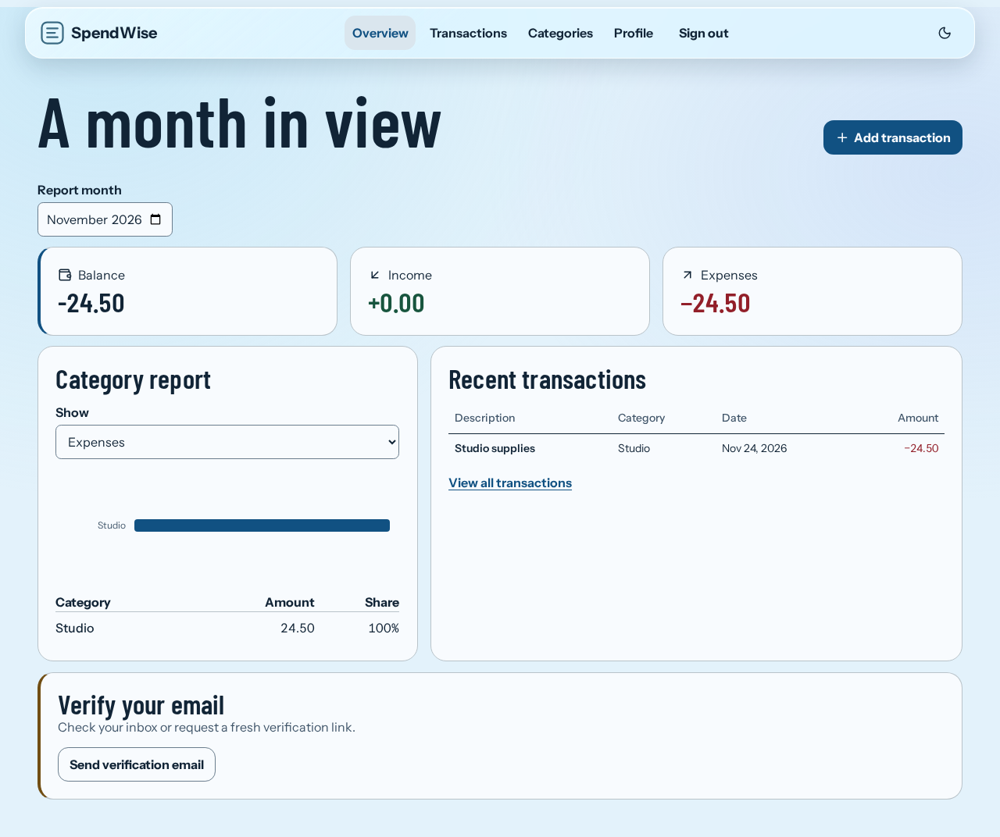

# SpendWise

[](https://github.com/Manan-2805/SpendWise/actions/workflows/ci.yml)
[](https://github.com/Manan-2805/SpendWise/actions/workflows/frontend.yml)

SpendWise is a personal expense tracker. Record income and expenses, organize them into categories, and review monthly totals and category breakdowns. The responsive web app supports light and dark themes, keyboard navigation, and reduced motion.



[Sign in](docs/screenshots/frontend/sign-in.png) · [Dark dashboard](docs/screenshots/frontend/dashboard-dark.png) · [Categories](docs/screenshots/frontend/categories.png) · [Mobile transactions](docs/screenshots/frontend/transactions-mobile.png)

## Run locally with Docker

Use Docker with Compose, GNU Make, and Python 3 for local settings generation.

```sh
git clone https://github.com/Manan-2805/SpendWise.git
cd SpendWise
python3 scripts/setup_dev.py
make up-build
make seed
make smoke
```

Open [SpendWise](http://localhost:3000) and sign in with the demo account printed by the first seed run, or create your own account. Compose runs nginx, FastAPI, Celery, PostgreSQL, Redis, and Mailpit. The migration container applies Alembic changes before the API starts. Rerun `make up-build` after changing frontend files.

## Verify an email address

The Docker development stack sends mail to [Mailpit](http://localhost:8025). Mailpit captures mail locally, including mail addressed to a real email address. Sign up or select **Send verification email**, open the message in Mailpit, and follow the link back to SpendWise.

To send to a real inbox, get SMTP credentials and approve a sender address or domain with your email provider. Some providers restrict sandbox accounts to approved recipients. For example, Amazon SES requires production access to send to arbitrary recipients. [Amazon SES SMTP credentials](https://docs.aws.amazon.com/ses/latest/dg/smtp-credentials.html) · [SES sandbox limits](https://docs.aws.amazon.com/ses/latest/dg/request-production-access.html)

Add the provider settings directly to your ignored local `.env`. Replace the example values with your own.

```dotenv
SPENDWISE_DEV_SMTP_HOST=smtp.example.com
SPENDWISE_DEV_SMTP_PORT=587
SPENDWISE_DEV_SMTP_FROM=notifications@example.com
SPENDWISE_DEV_SMTP_USERNAME=your-smtp-username
SPENDWISE_DEV_SMTP_PASSWORD=your-smtp-password
SPENDWISE_DEV_SMTP_STARTTLS=true
SPENDWISE_DEV_FRONTEND_URL=http://localhost:3000
```

Use your provider's STARTTLS endpoint, typically port 587. A local URL works when you open the email link on the machine running SpendWise. For someone opening it elsewhere, set `SPENDWISE_DEV_FRONTEND_URL` to an HTTPS address they can reach. Run `make up` to apply the settings and choose **Send verification email**. The app reports relay acceptance or failure. Use the provider's delivery log to check what happens after acceptance.

## Development checks

Install uv and Node.js 22.23.5 to run the checks on your machine.

```sh
make install
make frontend-install
make check
make frontend-check
```

The backend suite starts disposable PostgreSQL and Redis and enforces 85% line coverage. Frontend checks cover lint, type checking, Vitest, production build, contrast, and bundle budgets. With Playwright Chromium and its dependencies available, `make frontend-e2e` exercises the browser flow against disposable services.

To run the browser tests against the running Docker app, use `SPENDWISE_E2E_BASE_URL=http://localhost:3000 npm --prefix frontend exec -- playwright test`. That run creates a test account and sample data in the development database.

Regenerate API types with `make openapi` and `npm --prefix frontend run api:generate`.

## Project layout

| Path | Purpose |
|---|---|
| `frontend/` | React app with TanStack Query, React Hook Form, and Radix controls |
| `app/` | FastAPI routes, business rules, SQLAlchemy repositories, and Celery jobs |
| `alembic/` | PostgreSQL migrations |
| `docker/` | API images and optional monitoring resources |
| `docs/` | API contract, restore procedure, and maintenance records |

## Operations

- `make up` starts the Docker app with existing images. `make down` removes the containers and keeps the database volume.
- Production uses private PostgreSQL and Redis and HTTPS ingress. Set the environment variables listed in `docker-compose.prod.yml` through your deployment configuration, with credentials in its secret store. Use the `SPENDWISE_SMTP_*` variables for real mail, set `SPENDWISE_FRONTEND_URL` to the public HTTPS URL, and allow that exact origin in `SPENDWISE_CORS_ORIGINS`. Run `make prod-migrate` once with the migration role, then run `make prod-up`.
- See the [API contract](docs/api-contract.md) for authentication and proxy configuration and the [PostgreSQL restore runbook](docs/RESTORE.md) for backup and recovery.
