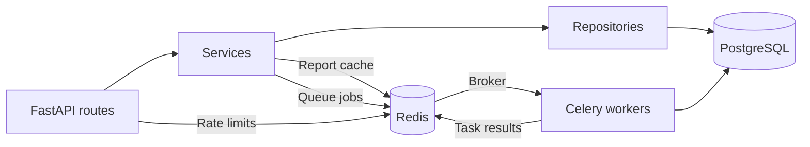

# SpendWise

[](https://github.com/Manan-2805/SpendWise/actions/workflows/ci.yml) [](#tests-and-checks)

SpendWise is a personal expense tracker with a React web app and a FastAPI backend. PostgreSQL stores transactions and Redis backs report caching, rate limits, and the Celery queue.

## Features

- Record income and expenses, manage categories, and filter transactions.
- View monthly summaries and category breakdowns in the dashboard. The API also exposes balance trends.
- Sign in, verify email, reset passwords, and manage your profile.

### Screenshots


[Dashboard in dark mode](docs/screenshots/frontend/dashboard-dark.png) · [Transactions on mobile](docs/screenshots/frontend/transactions-mobile.png)

## Quick start

On Linux or Windows with WSL2, install GNU Make, uv, and Docker with Compose. Run these commands from the repository root.

```sh
git clone https://github.com/Manan-2805/SpendWise.git
cd SpendWise
make install
make dev
```

Open the API at `http://localhost:8000/api/v1/health`. Development uses Uvicorn for reload. `make run` uses the same Granian ASGI server and worker model as the production image. Both targets start local PostgreSQL and Redis and apply migrations. Swagger, ReDoc, and OpenAPI are available when `DEBUG=true` outside production.

## API examples

These examples use a fresh local database. The values shown in the responses are examples. Use the ID returned by the category request and the access token returned by login.

```sh
api=http://localhost:8000/api/v1
curl -fsS "$api/auth/register" -H 'Content-Type: application/json' \
  -d '{"email":"demo@example.com","username":"demo","password":"DemoPass123!","confirm_password":"DemoPass123!"}'

curl -fsS "$api/auth/login" -H 'Content-Type: application/json' \
  -d '{"email":"demo@example.com","password":"DemoPass123!"}'
```

Both endpoints return an access token. For subsequent commands, set `token` to the returned `access_token`.

```json
{"access_token":"<access token>","token_type":"bearer","expires_in":1800}
```

```sh
curl -fsS "$api/categories/" -H "Authorization: Bearer $token" \
  -H 'Content-Type: application/json' -d '{"name":"Groceries","type":"expense"}'

curl -fsS "$api/transactions/" -H "Authorization: Bearer $token" \
  -H 'Content-Type: application/json' \
  -d '{"category_id":1,"amount":"24.50","description":"Groceries","transaction_date":"2026-11-20","type":"expense"}'

curl -fsS "$api/reports/monthly-summary?year=2026&month=11" \
  -H "Authorization: Bearer $token"
```

Category creation returns `201 Created` with a category ID, name, and type. The transaction also returns `201 Created`, with the transaction ID, category ID, and amount. For a database with only the sample expense, the report returns these totals.

```json
{"year":2026,"month":11,"income":"0","expense":"24.50","balance":"-24.50"}
```

## Architecture



## Repository map

```text
app/
  api/           Routes and request dependencies
  core/          Settings, authentication, Redis, logging, and tracing
  db/            Sessions and database helpers
  middleware/    Request context, timing, and security headers
  models/        SQLAlchemy mappings
  repositories/  PostgreSQL queries and persistence
  schemas/       HTTP contracts
  services/      Business rules and report caching
  worker/        Celery tasks and schedule
alembic/         Schema migrations
docker/          Image definitions and service provisioning
scripts/         Development and benchmark tools
tests/           Unit, integration, and load tests
```

Repositories centralize ownership filters and PostgreSQL queries. The API computes reports from transaction data and caches recurring queries in Redis. Redis also stores rate-limit counters and supports Celery as a broker and result backend. Beat schedules token maintenance and report generation.

| PostgreSQL tables | Purpose |
|---|---|
| `users` | Accounts and verification state |
| `categories`, `transactions` | User categories and financial entries |
| `refresh_tokens` | Refresh session history |
| `oauth_accounts` | Legacy provider-link table |
| `audit_logs` | Recorded account and financial events |

Transactions belong to a user and can reference a category. Refresh tokens also belong to users.

## Tests and checks

```sh
make test
make check
make pre-commit-install
```

Make starts disposable PostgreSQL and Redis on ports 55432 and 56379 for integration tests. `make test-unit` runs without those services. The full suite enforces 85% application line coverage, and CI builds the image after the hooks pass. The local verification on 2026-11-24 passed 181 backend tests at 88.25% coverage and 26 frontend tests. Ruff, Mypy, Bandit, and pip-audit also passed.

## Performance

A local test used 87% reads and reports, 12% transaction writes, and 1% logins. The load generator and services shared one WSL2 laptop with 4 vCPU and 5.8 GiB RAM. The final settings allow 16 in-flight requests per API worker.

| Round | Offered req/s | Successful req/s | Overall p95 | Readiness |
|---|---:|---:|---:|---:|
| 120-second baseline | 160 | 160.00 | 35.98 ms | 99.17% |
| 120-second final check | 160 | 159.53 | 35.85 ms | 100% |
| 60-second sweep | 240 | 235.33 | 127.43 ms | 100% |
| 60-second sweep | 640 | 198.02 | 221.71 ms | 100% |

The final 160 req/s round passed the thresholds but had worse throughput and more errors than the baseline. It returned 57 retryable `503` responses (0.30%). At 640 offered req/s, the sweep's `503` responses had a p95 of 154 ms and liveness stayed at 100%. [Full measurements and scope](docs/capacity.md)

These measurements apply to this laptop and workload. The 240 and 640 req/s results come from short sweep rounds. At 640 offered req/s, the API shed most requests.

```sh
make capacity CAPACITY_ARGS='--rates 160 --seconds 120'
```

## Known limits

- **A04, A06** · Redis TLS and isolation of broker and cache are deployment choices. Recovery tokens travel in Celery job payloads, and an enqueue failure after commit is logged without a durable retry.
- **A13, A14** · Soft-deleted users still reserve their email and username. Category PATCH lacks the create-time length checks for icon and description.
- **A23** · Transaction lists still use substring search and offset pagination.
- **A25, A26** · Most API integration tests override the request session. Default test invocations share a disposable stack, and the quick benchmark writes to that test database.
- **A27, A28** · Client-IP rate limiting depends on proxy configuration. Some container image references are mutable tags, and the metrics route relies on network access controls.

See the [original audit](docs/AUDIT.md) for finding IDs and the [restore drill](docs/RESTORE.md) for the manual backup procedure and recovery limits.

## Deployment

Build the production image with `make build` and publish a versioned tag to your registry. Provision PostgreSQL and Redis on private networks. Provide signing and database credentials through the deployment's secret store. Set the `SPENDWISE_*` values required by `docker-compose.prod.yml`, then run `make prod-migrate` once with the migration role before running `make prod-up`. Give the API and worker runtime roles only the access they require.

Run Granian behind HTTPS. Probe `/api/v1/health/live` for liveness and `/api/v1/health/ready` for PostgreSQL, Redis, and broker connectivity. Keep metrics and monitoring on the intended management network.

## Security and operations

- Keep local environment files and credentials out of Git and container builds.
- Production rejects debug mode, placeholder keys, and Redis URLs without authentication. Use a distinct signing key and authenticated Redis roles. Configure SMTP for verification and password-reset delivery.
- `make down` stops the development stack. **`make down-volumes` deletes the development database and Redis data.**
- `make logs` displays container logs. Keep recovery links and tokens out of log output.

## Troubleshooting

| Symptom | Check |
|---|---|
| uv cannot find Python 3.12 | Install the pinned Python version with uv, then rerun `make install`. |
| The API cannot reach its dependencies | Check Docker, then run `make dev-services`. Override `DEV_POSTGRES_PORT` or `DEV_REDIS_PORT` on the Make command if ports 15432 or 16379 are in use. |
| Swagger returns 404 | Set `DEBUG=true` for the development server. |
| Tests cannot connect | Check the disposable test PostgreSQL and Redis services. |

## SpendWise web app

Use Node 22.23.5 and npm 10.9.9. From the repository root, run `make frontend-install`, start the API with `make dev`, then run `make frontend-dev` in another terminal. Open http://localhost:3000. Vite requires port 3000 and proxies `/api/v1` with the browser's Host so both requests and HttpOnly cookies use the frontend origin.

Set the public build variable `VITE_CURRENCY` to an ISO currency code if you want localized currency display.

### Checks and deployment

- Run `make frontend-check` for ESLint, Vitest, strict TypeScript, a production build, contrast, and gzip budgets. After installing Playwright Chromium, `make frontend-e2e` runs the real browser flow with disposable PostgreSQL and Redis.
- Export typed API changes with `make openapi` and `npm --prefix frontend run api:generate`. The [runtime API contract](docs/api-contract.md) documents errors and session behavior.
- For development email, run `docker compose -f docker-compose.mailpit.yml --profile mailpit up -d mailpit` and open http://localhost:8025. Start the local worker with SMTP host `127.0.0.1`, port `1025`, a local sender, `SMTP_STARTTLS=false`, and an empty username. The standard development command leaves Mailpit disabled.
- The production Compose file includes the frontend nginx service. Serve it through a public HTTPS ingress that preserves the public Host. Supply `SPENDWISE_FRONTEND_URL` and set `SPENDWISE_CORS_ORIGINS` to an array with exactly that HTTPS origin at deployment. Keep deployment values out of Git. nginx serves SPA routes and proxies API paths on the same origin.
- Resolve the [nginx runtime image audit findings](docs/DEPENDENCY_CHANGES.md#production-image-audit--remediation-pending-approval) before production deployment.
